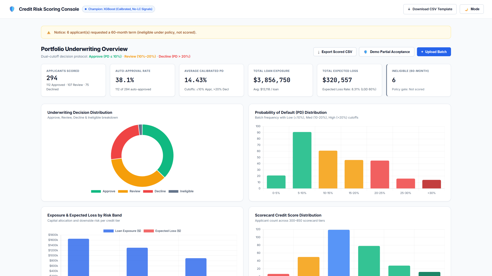

# Credit Risk Scoring

A leakage-free probability-of-default (PD) model for unsecured consumer loans, trained on
Lending Club data and served as an upload-and-score underwriting API with a dashboard.

For each applicant it returns a calibrated PD, a 300–850 scorecard number, a risk band and
decision (approve / review / decline), the expected loss, and the top four reasons behind
the score.

**Live demo: [credit-risk-scoring-i1im.onrender.com](https://credit-risk-scoring-i1im.onrender.com/)**
(free hosting, so the first visit after a quiet spell takes about a minute to wake up)



## Results

Out-of-time test window: **136,712 matured 36-month loans issued Apr–Sep 2015**, never used
for training, calibration, threshold tuning or model selection.

| | Value |
|---|---|
| Champion | LightGBM, isotonic-calibrated |
| ROC-AUC | **0.688** (95% bootstrap CI 0.685–0.692) |
| KS | **0.270** |
| Brier | 0.120 (before calibration: 0.226) |
| Riskiest decile | 32.1% default rate, **2.15×** the book average (safest decile: 3.3%) |
| Score stability (PSI train→test) | 0.006 (stable) |

All seven models land within 0.012 AUC of each other (0.677–0.688). Gradient boosting
beats logistic regression by about 0.01 AUC. This is about the ceiling for application
data alone on this dataset: what decides whether a loan defaults happens *after* it is
issued (job loss, illness).

**Calibration is the strongest result.** The policy bands hold up on the test window:

| Decision | PD band | Share of loans | Predicted default | Actual default |
|---|---|---|---|---|
| APPROVE | ≤ 10% | 39.4% | 6.7% | 6.9% |
| REVIEW | 10–20% | 36.1% | 15.3% | 15.5% |
| DECLINE | > 20% | 24.5% | 26.1% | 27.1% |

Full comparison: [`artifacts/model_comparison.csv`](artifacts/model_comparison.csv).
Every number above is written by one command (`python run_pipeline.py`). See
[`artifacts/run_info.json`](artifacts/run_info.json) for the exact periods and features.

## Design decisions

**1. No leakage.** Lending Club ships ~40 columns that only exist after a loan is issued
(`total_pymnt`, `recoveries`, `last_fico_*`, settlement and hardship fields). Adding just three of them
(`total_pymnt`, `recoveries`, `last_pymnt_amnt`) takes the same XGBoost from 0.687 to
**0.997** AUC on the same test window ([`scripts/leakage_demo.py`](scripts/leakage_demo.py)). They are dropped first ([`config.LEAKAGE_COLS`](config.py)),
and the trainer warns if any model goes above 0.90 AUC.

**2. Lending Club's own pricing is excluded.** `grade`, `sub_grade`, `int_rate` and
`installment` are LC's own risk model's output. The champion uses borrower attributes only.
Adding them back (`--with-lc-signals`) lifts AUC only from 0.688 to 0.703, so most of
what LC's grade knows is already in the application data.

**3. Only finished loans, split by time.** Loans whose 36-month term hadn't ended by the
data snapshot (2018-12, with a 3-month buffer) are dropped. Otherwise a loan that will default
later counts as "good" just because it isn't finished yet. Train Jan 2013–Dec 2014,
calibrate Jan–Mar 2015, test Apr–Sep 2015, with no shared months.

**4. Every statistic is learned on the training window only.** Median imputation and
winsorisation bounds live inside the sklearn pipeline, not in the cleaning step. If cleaning
computed them, test-period data would leak into training, and at scoring time an applicant's
score would depend on who else was in the uploaded file. A regression test covers this
([`tests/test_core.py`](tests/test_core.py)).

**5. Calibrated probabilities.** Class weighting helps ranking but inflates PDs (a true 8%
comes out around 35%). Isotonic calibration on the calibration window fixes that without
changing the ranking, so the PDs can drive the bands and expected loss (`EL = PD × LGD × EAD`,
LGD 0.60).

**6. Champion chosen on the calibration window, not the test window.** The test window
only reports. The threshold for the precision/recall table is tuned on the calibration
window too.

**7. Explainable by construction.** Only models with exact per-applicant attributions can
become champion: native TreeSHAP for boosters, TreeExplainer for random forests, coefficient
× value for logistic regression. One-hot columns are summed back into their source feature,
so reasons read "Home ownership (RENT)", not `home_ownership_RENT`.

**8. One policy, one place.** Band cut-offs, decisions, LGD and scorecard scaling are defined
once in [`config.py`](config.py), saved into the model bundle, and read by the API and the
dashboard.

## Fairness audit

Lending Club has no protected attributes, so [`src/fairness.py`](src/fairness.py) audits the
proxy segments that are available (income quartile, region, home ownership, income
verification). Output: [`artifacts/fairness_report.csv`](artifacts/fairness_report.csv).

- **Calibration is even across all groups** (|predicted − actual| ≤ 1.2 pp everywhere), and
  approved loans default at 6.4–7.8% in every segment. The model is equally accurate for
  every group.
- **Approval rates are not even.** The lowest income quartile is approved at 15% vs 64% for
  the highest (adverse impact ratio 0.24), and renters at 27% vs 52% for mortgage holders.
  These fail the four-fifths screening rule. Income and housing are legitimate underwriting
  factors and these groups really do default more (19% vs 11%), but a lender would still
  have to document business necessity and look for less discriminatory alternatives before
  deploying.
- Region passes (AIR ≥ 0.95).

## Run it

```bash
pip install -r requirements-dev.txt

# Train on the real data (download accepted_2007_to_2018Q4.csv from
# kaggle.com/datasets/wordsforthewise/lending-club into data/). ~6 min on 12 cores.
python run_pipeline.py

# Or try it right away on synthetic data with the same schema and mess
python scripts/make_sample_data.py --rows 50000
python run_pipeline.py --data data/sample_loans.csv

# Serve the API + dashboard at http://127.0.0.1:8000
python app.py

# Tests and lint
pytest -q
ruff check app.py config.py run_pipeline.py src tests
```

With Docker:

```bash
docker build -t credit-risk-scoring .
docker run -p 8000:8000 credit-risk-scoring
```

### API

Latency, measured in-process on a 12-core desktop: 46 ms median for one applicant,
280 ms for a 300-row batch (validation, features, scoring and reason codes included).

| Endpoint | |
|---|---|
| `POST /api/score` | Upload a CSV (≤ 5 MB) and score every row. Invalid rows are reported per row and the rest are still scored. 60-month loans are flagged as outside model scope. |
| `GET /api/health` | Model name, training date, test AUC/KS, thresholds |
| `GET /api/template` | Blank CSV with the required columns |
| `GET /api/demo-batch` | 300 sample applicants |

## Project layout

```
config.py            every tunable: periods, features, leakage list, policy thresholds
run_pipeline.py      raw CSV -> cleaned data -> models -> champion -> all artifacts
app.py               FastAPI scoring service + static dashboard
src/
  data_loader.py     CSV / Excel / parquet / API ingestion
  quality.py         completeness, validity, consistency, uniqueness scoring
  cleaning.py        leakage removal, target, parsing, maturity filter, dedupe
  features.py        engineered ratios, time split, train-fitted preprocessor
  models.py          model zoo, calibration, evaluation, champion selection
  risk.py            bands, decisions, scorecard, expected loss, PSI, reason codes
  explain.py         per-applicant attributions for any champion type
  fairness.py        segment audit (adverse impact, calibration, AUC by group)
dashboard/           front end (vanilla JS + Chart.js)
tests/               unit tests (core logic) + API tests
artifacts/           everything run_pipeline.py writes; never edited by hand
docs/research_paper.md
archive/             superseded coursework deliverables (old numbers, see its README)
```

## Limitations

- **Selection bias.** The model only ever sees loans Lending Club approved. Its PDs for the
  kind of applicant LC rejected are extrapolations. Reject inference using LC's rejected-loans
  file is the obvious next step.
- **One out-of-time window.** The test window is six months of 2015. Walk-forward validation
  over several windows would give a more reliable read on stability.
- **No hyperparameter search.** Models use hand-set regularised defaults. Given how close they
  all are, tuning is unlikely to move AUC by more than about 0.005.
- **Fixed LGD.** Expected loss uses a flat 60% LGD rather than a modelled one.
- **Proxy-only fairness.** No protected attributes are available.

## Authors

Team 7, Data Science: Bhanu Prakash (2420030209), Krishita Myneni (2420030443),
Laasya Priya (2420030002).

Dataset: Lending Club accepted loans 2007–2018Q4 (2.26M rows × 151 columns),
[Kaggle](https://www.kaggle.com/datasets/wordsforthewise/lending-club).
